# Sekvencijalna optimizacija prostornih upita

**Stanje mjerenja:** 22. 11. 2026. Cilj ove faze je ispravna i brža sekvencijalna obrada. Paralelizacija ostaje za kasnije.

## 1. Nalaz i preporuka

Početni VTune Hotspots odnosio se na PSI KD-stablo, dok su V1-V4 posebni brute-force eksperimenti. Zbog toga ih treba objašnjavati odvojeno: prethodno ubrzanje V4 ne znači da je isto poboljšano projektno PSI stablo. U ovoj fazi izrađen je zaseban CMake cilj `psi_seq_opt`; `psi_seq` je sačuvan kao referenca. Oba rade jednom niti.

Za glavni ulaz N=200.000, M=2.000, uniformno, w=0,02, medijan obrade upita bio je **4.41 ms** za `psi_seq` i **2.68 ms** za `psi_seq_opt`: 1.65×, odnosno 39.2% manje vremena upita. Ovi brojevi se odnose na zagrijane upite, ne na ukupno pokretanje. Medijan izgradnje stabla bio je 21.11 ms i 21.19 ms.

**Preporuka:** koristiti `psi_seq_opt` za nastavak mjerenja PSI sekvencijalnog programa i zadržati `psi_seq` kao kontrolu. Brute-force V4 ostaje zasebna poredbena varijanta; eksperimentalna V5 nije opće poboljšanje. Nije dokazano da je bilo koja verzija globalno optimalna za sve ulaze i mašine.

## 2. Šta je urađeno i šta je tražila grupa

Prostorni upit traži sve tačke unutar pravougaonika: xmin ≤ x ≤ xmax i ymin ≤ y ≤ ymax. Granice su uključene, a tačke s istim koordinatama i različitim ID-jevima ostaju različiti rezultati. Brute-force provjerava svaku od N tačaka za svaki od M upita, što daje O(N × M) provjera. PSI koristi KD-stablo koje može preskočiti dijelove prostora, uz dodatni trošak izgradnje indeksa.

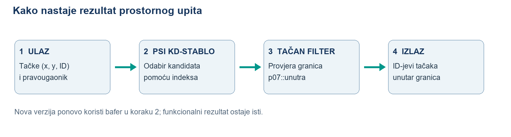

Dijagram prikazuje odnos cijelog zadatka i mjesta optimizacije. Pravougaonici se najprije pretvaraju u PSI format; stablo pronalazi kandidate, a završni uslov p07::unutra vraća ID-jeve koji zaista zadovoljavaju tačne granice.

Grupa je tražila identificiranje funkcija koje troše najviše vremena, pokušaj odmotavanja petlje, poboljšavanje najskupljeg dijela, podjelu rada na jasne funkcije i simbole za VTune/PDB. Ranije su urađeni VTune Hotspots, razdvojene mjerne funkcije i verzije V1-V4, uključujući odmotavanje i AVX2. Sada je dodatno analiziran i unaprijeđen stvarni sekvencijalni PSI put. Windows Microarchitecture i PDB treba tumačiti prema konkretno potvrđenom rezultatu profiliranja, a ne zaključivati samo iz postojanja PDB datoteke.

Tok rada: (1) početno profiliranje sekvencijalnog PSI stabla, (2) razvoj i provjera brute-force verzija, (3) PDB i hardverski VTune na Windowsu, (4) ispitivanje nove ideje V5 i (5) posebna optimizacija PSI pretrage pomoću bafera. Početni WSL Hotspots za PSI imao je N=200.000, M=20.000, 20 ponavljanja i --no-check; prikazano vrijeme 1,612 s opisuje taj konkretan profil, ne V4 i ne potvrđuje ispravnost. Windows matrix.exe bio je samo provjera profilera.

Referentni `tree.range_query(box)` u PSI biblioteci najprije određuje veličinu rezultata, a zatim alocira i ponovo obilazi stablo. Nova varijanta koristi PSI preopterećenje koje upisuje u prethodno pripremljen bafer. Taj se bafer zadržava između upita i ponavljanja. Ako se napuni, proširuje se i cijeli upit ponavlja dok nema dovoljno mjesta, ili kapacitet ne dosegne broj ulaznih tačaka. Ne prihvata se tiho skraćen rezultat. Zadržan je `p07::unutra` jer PSI može koristiti toleranciju granica.

Ova optimizacija ima cijenu: privremeni bafer može narasti do N tačaka, a upit se ponavlja pri proširenju. Valjanost pravougaonika unaprijed se određuje samo u novoj varijanti, izvan mjerenog dijela upita; to je dio implementacije i bitno za pošteno tumačenje vremena. Izvorna biblioteka i postojeći cilj `psi_seq` nisu zamijenjeni.

## 3. Ispravnost

CTest: **4/4 prolaze**. Izvorni testni program prijavio je 23 prolaza; dodatni test obuhvata rubove, duplikate, prazan ulaz i puni odnosno nedovoljni bafer, a još dva testa pokreću novi CLI uključujući N=0/M=0. Za svih osam scenarija obje verzije dodatno su zasebno pokrenute bez `--no-check`: rezultat svakog upita poređen je s brute-forceom kao sortirani niz ID-jeva. U svih 16 provjera ispisan je `OK`. Sortiranje je potrebno jer redoslijed KD-stabla može biti drugačiji. To je dokaz za ispitane ulaze, ne matematička garancija za sve moguće podatke.

U zasebnom eksperimentu V1-V4 su provjereni puni nizovi ID-jeva uključujući njihov redoslijed, rubne i neparne ulaze. Build s P07_DISABLE_AVX2 provjeren je na manjim uniformnim i grupisanim ulazima, čime je ispitan i skalarni povratni put. PSI poređenje se razlikuje jer redoslijed nije definisan jednako kao kod brute-forcea. Konačni bafer je ispitan i za tačno popunjavanje te ponovno proširivanje.

Nakon izmjena su uspješno kompajlirani i već postojeći ciljevi `psi_omp` i `psi_parlay`, koji dijele istu izvornu datoteku. To je regresijska provjera kompilacije, a ne nova paralelizacija niti mjerenje njihovih performansi.

## 4. Poređenje stvarnog PSI programa

Obje verzije izgrađene su u istom WSL Release okruženju s G++ 14 i istim ulazima/seed 42. Za svaki scenario pokrenuto je pet nezavisnih procesa po verziji, naizmjeničnim redoslijedom. Svaki proces prijavio je medijan sedam mjerenja nakon zagrijavanja. Tabela prikazuje medijan pet tih vrijednosti; opseg je najmanji i najveći od pet zaokruženih procesnih medijana, ne interval pouzdanosti. U pripremu i cijelo trajanje procesa ovdje se ne ulazi.

Mjerenja iz ranije projektne dokumentacije rađena na AMD Ryzen 5 7530U ne porede se direktno s ovdje prikazanim mjerenjima na Intel računaru: različiti procesor i okruženje mijenjaju rezultate.

| Raspodjela / w | N / M | Referenca upiti ms (raspon) | Opt. upiti ms (raspon) | Ubrzanje |
| --- | --- | ---: | ---: | ---: |
| Uniformno / 0,005 | 200,000 / 2,000 | 1.71 (1.63-1.94) | 1.00 (0.89-1.11) | 1.71× |
| Uniformno / 0,02 | 200,000 / 2,000 | 4.41 (4.37-4.63) | 2.68 (2.66-2.95) | 1.65× |
| Uniformno / 0,1 | 200,000 / 2,000 | 27.05 (26.19-27.77) | 18.81 (18.27-20.17) | 1.44× |
| Grupisano / 0,005 | 200,000 / 2,000 | 0.61 (0.55-0.62) | 0.37 (0.36-0.38) | 1.65× |
| Grupisano / 0,02 | 200,000 / 2,000 | 2.02 (1.88-2.42) | 1.23 (1.18-1.51) | 1.64× |
| Grupisano / 0,1 | 200,000 / 2,000 | 21.05 (19.63-21.57) | 14.48 (14.14-15.43) | 1.45× |
| Mali / 0,02 | 20,000 / 200 | 0.12 (0.12-0.14) | 0.07 (0.05-0.07) | 1.71× |
| Veliki / 0,02 | 1,000,000 / 2,000 | 13.72 (13.14-15.29) | 10.06 (9.33-10.17) | 1.36× |

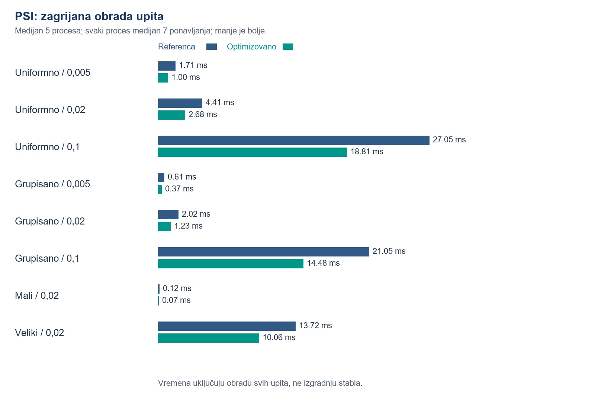

U svih osam izmjerenih slučajeva novi cilj je brži u mjerenoj fazi upita. Širina i raspodjela mijenjaju broj pogodaka, a samim tim i trošak rada i upisa rezultata. Mali slučaj je naročito osjetljiv na zaokruživanje jer program ispisuje vremena na 0,01 ms.

Izgradnja se mjeri zasebno nakon pravljenja kopije podataka; ispis programa „ukupno“ je zbir medijana faza, a ne nužno stvarno izmjereno vrijeme jednog potpunog pokretanja. Zbog toga iz omjera upita ne slijedi isti omjer kompletnog programa.

Za dodatni uvid provedeno je drugo mjerenje u uporedivom eksperimentalnom programu: sedam zasebnih procesa s jednom gradnjom i jednim skupom upita bez zagrijavanja aplikacije. Za uniformno w=0,02 medijani od početka generisanja do kraja upita iznose 37.57 ms i 36.80 ms. OS/CPU cache nije čišćen, završavanje procesa nije uključeno, a ovo je eksperimentalni program - ne zamjenjuje rezultat integrisanih ciljeva.

## 5. Šta znače prethodne verzije brute-forcea

| Verzija | Glavna ideja |
| --- | --- |
| Referenca | Skalarni pregled svih tačaka, raspored AoS. |
| V1 | Odvojeni nizovi x, y i ID (SoA); skalarni pregled. |
| V2 | SoA i ručno odmotana petlja po četiri tačke. |
| V3 | Najprije se izdvajaju kandidati po x, zatim provjerava y. |
| V4 | SoA i AVX2 za grupe od četiri `double`, uz skalarni povratni put. |
| V5 eksperiment | Najprije maska po x; y se preskače kad nijedna x koordinata ne odgovara. |

Ranija serija na glavnom ulazu dala je medijane reference/V1/V2/V3/V4: 1084,58 / 964,96 / 907,80 / 952,77 / 121,14 ms za zagrijane upite. V4 je bila 8,95× brža od brute-force reference u toj seriji. To nije mjerenje PSI KD-stabla niti ukupno vrijeme rada.

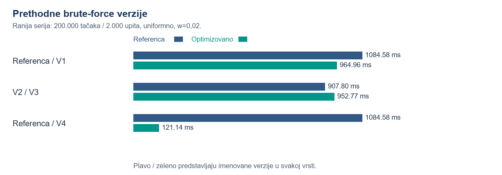

U novoj zasebnoj seriji provjeren je pokušaj V5. Na uskim pravougaonicima može pomoći, ali na širim može biti sporiji jer dodatno grananje i maske nose trošak. Zato V5 nije proglašena općom zamjenom za V4. Detaljni uzorci i testovi sačuvani su u projektnim datotekama.

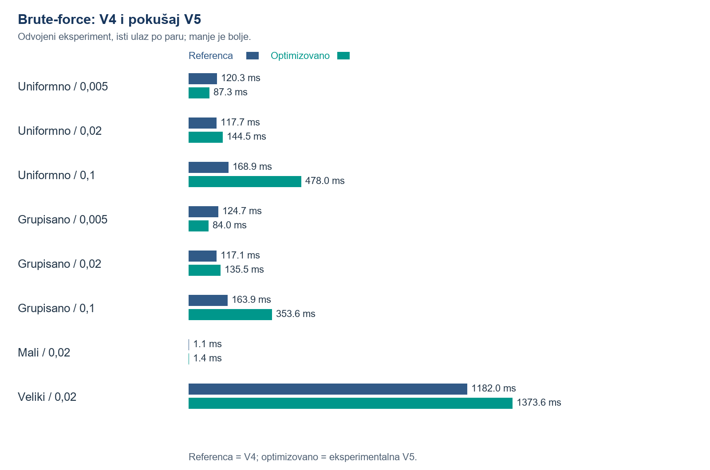

### Kako se verzije razlikuju tokom izvršavanja

Referenca pregledava niz struktura (AoS) i za svaku tačku skalarno provjerava obje koordinate. V1 prebacuje x, y i ID u odvojene nizove (SoA), ali ih i dalje provjerava skalarno. V2 ručno obrađuje četiri tačke po iteraciji i ima poseban ostatak; odmotavanje samo po sebi ne znači paralelni rad niti.

V3 u jednom prolazu izdvaja x-kandidate, pa nad njima provjerava y. Time štedi neke provjere, ali plaća dodatnim prolazom i privremenim indeksom; ona je alternativa, a ne nadogradnja V2. V4 obrađuje po četiri double vrijednosti pomoću AVX2 i maske, uz skalarni ostatak i povratni put ako AVX2 nije dostupan. SIMD ne mijenja činjenicu da je to ovdje sekvencijalan program u jednoj niti.

Za poređenje V1-V4 korišten je zajednički ulaz u istoj seriji; priprema AoS i SoA reprezentacija obuhvaćena je zajedno i ne može se dijeliti po verzijama. Zagrijana obrada ponovo koristi kapacitet izlaznih vektora. Ovi brojevi i nova mjerenja PSI stabla opisuju različite algoritme i ne smiju se predstaviti kao vremenski niz jedne implementacije.

### Deset metrika ranijih brute-force verzija

Vrijeme je mjereno u WSL/G++14 na N=200.000, M=2.000, uniformno, w=0,02, seed 42: zagrijavanje pa sedam ponavljanja uz rotaciju redoslijeda. Memorija je snimljena zasebno s M=200; Windows VTune/Clang hardverski podaci su opet zasebna mjerenja. U pojedinim Windows profilima reference i V1-V3 izvršeno je šest, a V4 80 ponavljanja. Zbog različitog trajanja, migracije P/E jezgri i MUX-a one su indikativne, ne strogo kontrolisano poređenje.

#### 1. Vrijeme obrade upita (medijan)

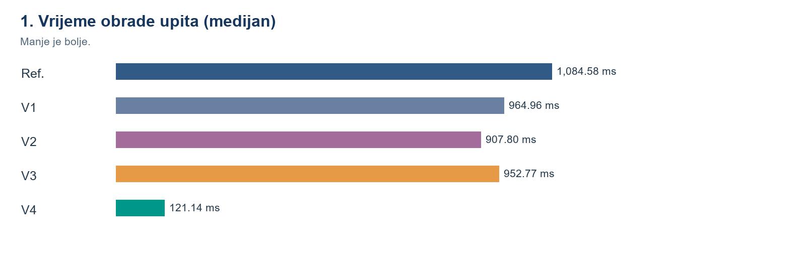

Medijan je srednja vrijednost sedam sortiranih uzoraka. V4 ovdje obrađuje grupu upita za 121,14 ms, dok referenca treba 1.084,58 ms. Priprema nije uključena.

#### 2. Raspon izmjerenih vremena

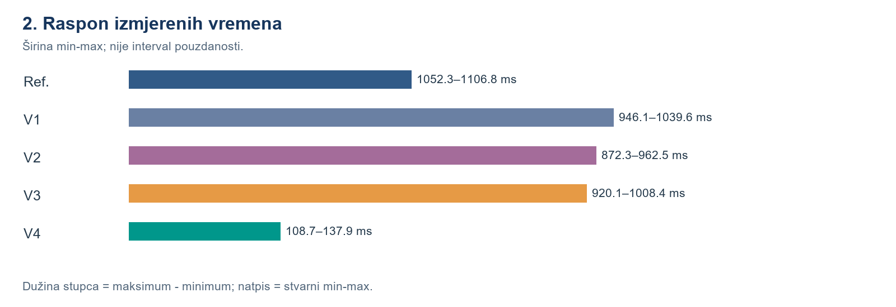

Za svaku verziju prikazani su najmanje i najveće izmjereno vrijeme; dužina stupca je razlika između njih. Sedam uzoraka ne određuje interval pouzdanosti niti garantuje buduću stabilnost.

#### 3. Ubrzanje prema referenci

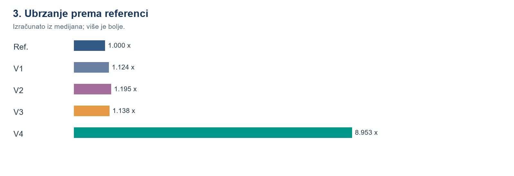

Ubrzanje = medijan reference / medijan verzije. V4 postiže 8,95 puta na istom ulazu i u istoj mjerenoj fazi; ovo nije ubrzanje čitavog pokretanja niti rezultat paralelizacije.

#### 4. Propusnost

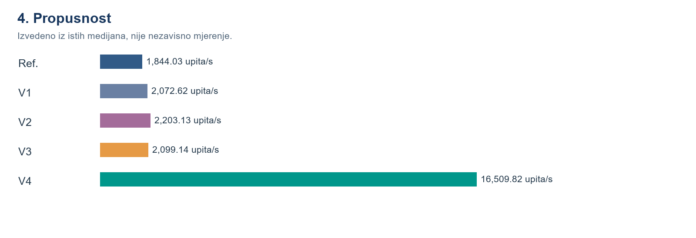

Propusnost = 1.000 × M / vrijeme u ms. To je drugi način prikaza istog mjerenja, ne nezavisno mjerenje rada servera.

#### 5. Vršni živi heap i overhead

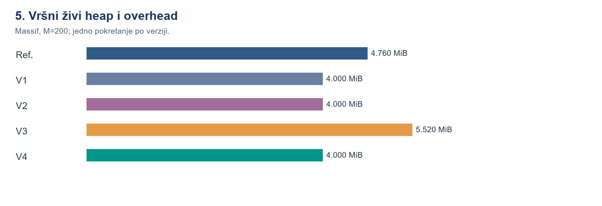

Vršni živi heap uključuje dinamički alociranu memoriju i overhead alokatora, bez steka. V3 ima dodatni bafer kandidata; rezultat se odnosi na jedno pokretanje s M=200.

#### 6. Maksimalni rezidentni skup

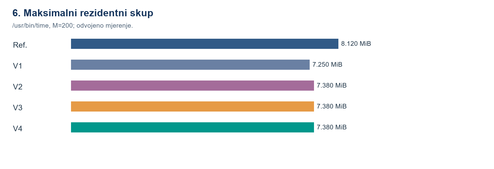

RSS je vršni rezidentni skup stranica procesa, koji obuhvata i dijelove izvan heapa. Zato se ne izjednačava niti sabira s Massif vrijednošću.

#### 7. CPI - Windows P-core

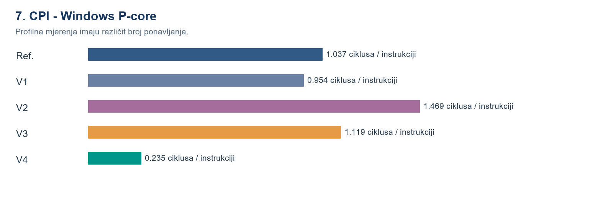

CPI je broj ciklusa po završenoj instrukciji. Budući da verzije izvršavaju različite instrukcije i različit broj ponavljanja, sam CPI ne dokazuje razlog bržeg izvršavanja.

#### 8. Retiring - Windows P-core

Retiring procjenjuje dio pipeline slotova u kojima su instrukcije završene korisnim radom na P-jezgrama. Procjena nije procenat ukupnog vremena čitavog programa.

#### 9. Back-End Bound - Windows P-core

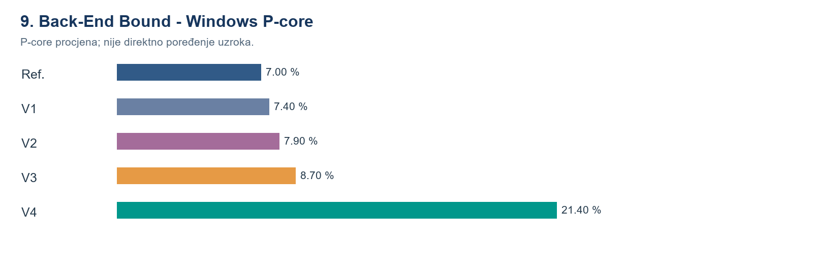

Back-End Bound procjenjuje ograničenja izvršnog dijela procesora. Povećan udio sam ne znači da je apsolutno vrijeme rada poraslo, jer se ukupno trajanje verzija razlikuje.

#### 10. Memory Bound - Windows P-core

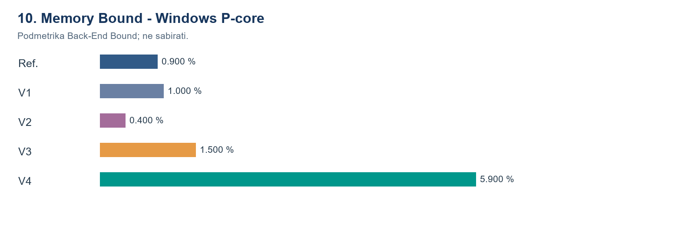

Memory Bound je dio Back-End Bound vezan za memorijski podsistem. To je podmetrika i ne sabira se s Back-End vrijednošću; različiti profili daju samo indikaciju.

Windows procesni P-core brojači u ovoj starijoj seriji dolaze iz zasebnih profila. Za kompletan VTune rezultat MUX je bio 0,885 / 0,994 / 0,957 / 0,992 / 0,990 za Ref./V1/V2/V3/V4; referentni profil time ima slabiju pokrivenost. Noviji PSI profili u narednom poglavlju nastali su drugim programima i uslovima.

### Ranije verzije na više ulaza

Na sljedećem prikazu prvih šest redova ima N=200.000 i M=2.000, uz navedenu raspodjelu i širinu; posljednja dva reda su uniformna, w=0,02. Intenzitet boje zavisi od vrijednosti u tom redu, pa se boje ne smiju koristiti za poređenje brzine između redova. To je prethodna brute-force serija, a ne novo mjerenje PSI verzija.

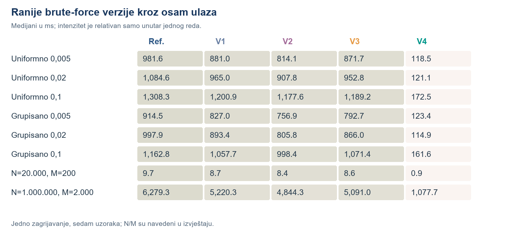

V4 je najbrža u svim ovdje prikazanim redovima, ali veličina dobitka varira. Sedam uzoraka po ulazu ne određuje performanse na svim budućim podacima.

## 6. VTune i memorija

Raniji WSL Hotspots profil odnosio se na PSI `psi_seq` i prikazao funkcije pretrage stabla i provjere granica. Prvobitni Windows `matrix.exe` bio je provjera hardverskog profilera i nije projektni rezultat. Sada su zasebno snimljene obje stvarne PSI verzije pomoću Windows VTune **Microarchitecture Exploration** i hardverskog uzorkovanja; rezultati, CSV izvodi i EXE/PDB parovi su sačuvani.

Profilni Windows build koristi Clang `-O3`, PDB/CodeView i `P07_PROFILE_MARKERS`, koje olakšavaju pronalaženje faza ali mogu promijeniti optimizacije. Ulaz je N=200.000, M=20.000, w=0,02, uniformno, seed 42, 20 ponavljanja i `--no-check`. Snima se cijeli rezultat pokretanja preko cmd.exe, uključujući pripremu i izgradnje. Ispravnost je provjerena odvojeno. Mjerenja u nastavku su po jedno uzorkovano pokretanje, nisu WSL Release benchmark i ne dokazuju uzročnost.

| VTune pokazatelj | Referenca | Optimizovana |
| --- | ---: | ---: |
| Proteklo vrijeme (s) | 1.887 | 1.456 |
| Završene instrukcije (milijarde) | 9.420 | 6.689 |
| CPI | 0.909 | 0.940 |
| MUX pouzdanost | 0.991 | 0.993 |
| P-core Retiring (%) | 24.8 | 23.6 |
| P-core Front-End Bound (%) | 19.0 | 16.7 |
| P-core Bad Speculation (%) | 12.6 | 21.5 |
| P-core Back-End Bound (%) | 43.7 | 38.2 |
| P-core Memory Bound (%) | 24.6 | 15.7 |

Proteklo vrijeme odnosi se na cijeli VTune rezultat s konkretnim profilnim buildom. Razlika ne predstavlja procjenu stabilnog ubrzanja bez ponovljenih mjerenja.

Završene instrukcije ukazuju na obim izvršenih instrukcija u profilu; varijante mogu raditi različite instrukcije, pa sam broj ne objašnjava vrijeme.

CPI je broj ciklusa po završenoj instrukciji. Sam po sebi ne govori koja verzija završava posao brže jer se razlikuje i ukupan broj instrukcija.

MUX Reliability pokazuje pouzdanost procjene kada VTune dijeli ograničen broj hardverskih brojača; vrijednost bliža 1 ovdje ukazuje na visok nivo pokrivenosti, ali nije garancija tačnosti svakog zaključka.

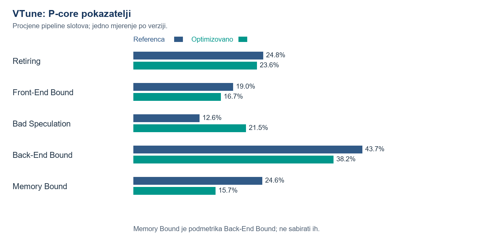

Retiring se odnosi na završeni korisni rad u pipelineu; Front-End Bound na ograničenja dobave i dekodiranja instrukcija; Bad Speculation na izgubljeni rad zbog pogrešnih spekulacija; Back-End Bound na čekanja i ograničenja izvršnog dijela. Memory Bound je podmetrika Back-End Bound i odnosi se na memorijski dio. Ovi podaci su procjene za P-jezgra, ne procenat ukupnog vremena aplikacije. Podmetriku ne treba sabirati s roditeljskom.

U grupisanom izvozu funkcija početnog PSI profila, među najznačajnijim granama su `comparator::lt` oko 0,526 s, `find_bucket` oko 0,126 s, `box_intersect_box` oko 0,125 s i `within_box` oko 0,110 s samostalnog CPU vremena, zbrojeno po odgovarajućem nazivu i lokacijama. To su procjene uzorkovanja i ne moraju se sabirati u ukupno proteklo vrijeme. PDB je omogućio prikaz projektnih i PSI funkcija/linija, uključujući `psi_seq_buffer.h` i `psi_benchmark.cpp`; nedostaju simboli nekih sistemskih DLL-ova. Broj niti u ukupnom rezultatu može obuhvatiti `cmd.exe` i pomoćne procese; sam projektni program prijavljuje jednu nit.

### Memorija integrisanih PSI verzija

Zasebno su izmjerene obje stvarne verzije na WSL Release buildu: uniformno N=200.000, M=2.000, seed 42, jedno zagrijavanje i jedno ponavljanje, bez provjere. Program pri tome gradi stablo dva puta i obrađuje dvije grupe upita; generisanje ulaza je uključeno. Massif mjeri jedan proces bez steka; vrh je živi heap plus dodatni prostor alokatora. RSS je medijan vršnih rezidentnih skupova tri procesa. To su različite metrike u odvojenim pokretanjima, a ne količina memorije samog bafera.

| Širina | Heap ref. / opt. (MiB) | RSS ref. / opt. (MiB) |
| --- | ---: | ---: |
| 0.02 | 49.75 / 49.75 | 38.88 / 39.00 |
| 0.1 | 63.42 / 64.17 | 52.62 / 53.12 |

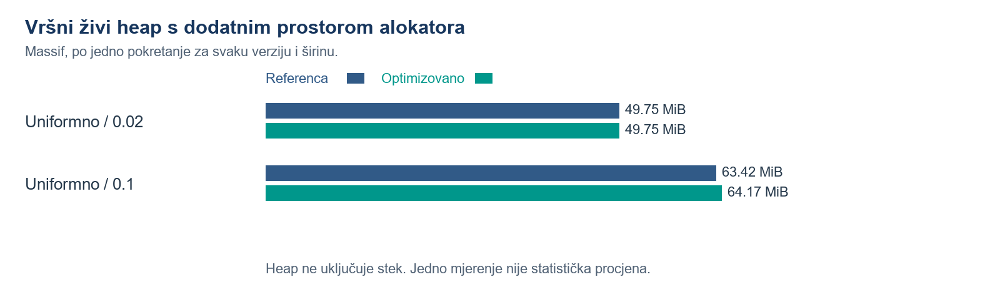

Heap prikazuje koliko je dinamičke memorije bilo živo na vršnom Massif snimku. Optimizovana verzija ovdje ima neznatno veći vrh; rezultat ne dokazuje koliko je memorije privremeni bafer trošio u svim trenucima. Za w=0,02 je u stablu alokacija vršnog snimka reference među značajnim granama `parlay::internal::block_allocator::alloc()` s 12.845.232 B, uključujući put vezan za izgradnju KD-stabla. To je atribucija grani poziva u tom snimku, ne memorija koju funkcija trajno posjeduje; inline optimizacije ograničavaju preciznost.

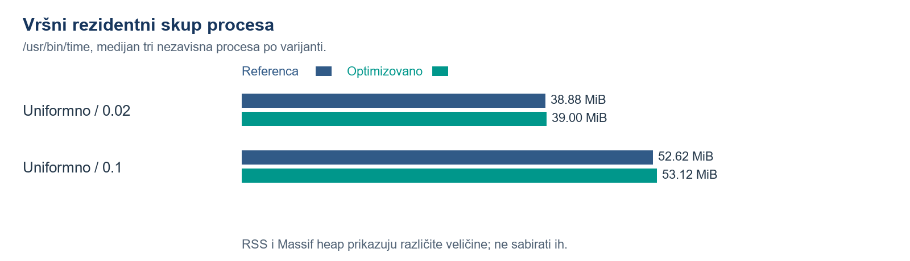

RSS pokazuje vršni broj rezidentnih memorijskih stranica procesa i uključuje više od heap alokacija. Medijan tri ponavljanja smanjuje uticaj jednog očitanja, ali ne garantuje da će rezultat biti isti kod drugih ulaza. Heap i RSS se ne sabiraju niti direktno izjednačavaju.

